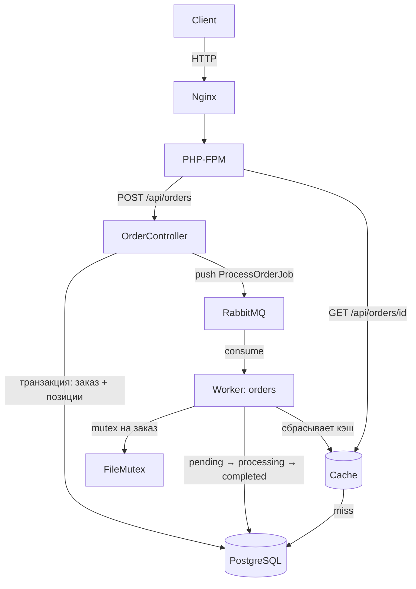

# Yii2 Order Flow


Учебный REST API для работы с заказами на Yii2. Создание заказа ставит задачу в очередь RabbitMQ, воркер обрабатывает её асинхронно, а чтение заказа по ID идёт через кэш.

Проект сделан, чтобы отработать на практике типичные для бэкенда вещи: очереди и повторные попытки, кэширование с инвалидацией, защиту от гонок между воркерами, тесты трёх уровней и CI. В конце README честно перечислено, что в проекте сделано упрощённо и что я бы менял в первую очередь.

## Стек

- PHP 8.4, Yii2 Advanced
- PostgreSQL 16
- RabbitMQ 3 (образ `rabbitmq:3-management`)
- Redis 7 (кэш в локальном окружении)
- Nginx + PHP-FPM, всё в Docker Compose
- Codeception (Unit, Functional, Integration), PHPStan level 5
- GitHub Actions
- Swagger/OpenAPI (`zircote/swagger-php`)

## Как это работает



Шаги:

1. `POST /api/orders` валидирует данные (`CreateOrderForm`), в одной транзакции сохраняет заказ и позиции в PostgreSQL, считает сумму и кладёт `ProcessOrderJob` в очередь `orders`. Клиент сразу получает `201`.
2. Воркер забирает задачу и берёт mutex по имени `order_{id}` (ожидание до 10 секунд). Если блокировку взять не удалось, задача завершается без обработки. Дальше заказ проходит `pending → processing → completed` через проверку `Order::canTransitionTo()`. После завершения кэш заказа сбрасывается.
3. `GET /api/orders/{id}` сначала смотрит в кэш, при промахе читает из БД и кладёт результат в кэш на 300 секунд.

### Статусы заказа

`pending → processing → completed`, а также `pending/processing → failed` и `failed → pending`. `completed` конечный. Допустимые переходы описаны в `Order::canTransitionTo()` и покрыты unit-тестами.

## Очереди и обработка ошибок

- Две очереди: `orders` (заказы) и `notifications` (email), у каждой свой воркер (`worker`, `worker-notifications`).
- Повторные попытки настроены на уровне приложения: `attempts => 3` у компонента очереди и `ProcessOrderJob::canRetry()`. Ошибки, которые повтором не исправить (`OrderNotFoundException`, `LogicException`), помечены как не повторяемые.
- Обработчик `on afterError` складывает упавшую задачу в «мёртвую» очередь (`orders_dead`, `notifications_dead`) через отдельные компоненты `queueOrdersDead` и `queueNotificationsDead`.
- Защита от параллельной обработки одного заказа: mutex `order_{id}`. Сейчас это `FileMutex` (см. ограничения).

## Запуск

Нужны Docker и Docker Compose.

```bash
git clone https://github.com/velial1108/yii2-order-flow.git
cd yii2-order-flow

# локальные конфиги из шаблонов
for f in common/config/main-local common/config/params-local common/config/test-local \
         frontend/config/main-local frontend/config/params-local frontend/config/test-local \
         console/config/main-local console/config/params-local; do
  cp "$f.php.dist" "$f.php"
done

docker compose up -d --build
docker compose exec app composer install
docker compose exec app php yii migrate --interactive=0
docker compose exec app php yii swagger/generate
```

На Windows (PowerShell) конфиги проще скопировать вручную или через Git Bash, остальные команды те же.

Важно: шаблоны `*.php.dist` описывают минимальное окружение (как в CI). Redis-кэш, DLQ-компоненты и обработчики `afterError` сейчас есть только в рабочем `main-local.php`, см. ограничения.

После запуска доступно:

| Сервис | Адрес |
|---|---|
| API | http://localhost:20080/api/orders |
| Swagger UI | http://localhost:20080/api-doc |
| RabbitMQ Management | http://localhost:15672 |
| PostgreSQL | localhost:5433 |
| Redis | localhost:6379 |

Логин и пароль RabbitMQ задаются в `docker-compose.yml`.

## API

| Метод | Путь | Описание |
|---|---|---|
| GET | `/api/orders` | Список заказов, по 20 на страницу |
| GET | `/api/orders/{id}` | Заказ по ID, ответ кэшируется на 5 минут |
| POST | `/api/orders` | Создать заказ |
| GET | `/api/health` | Проверка работоспособности |
| GET | `/api/test-email` | Служебный: ставит задачу в очередь `notifications` |

Пример создания заказа:

```bash
curl -X POST http://localhost:20080/api/orders \
  -H "Content-Type: application/json" \
  -d '{
        "user_id": 1,
        "items": [
          {"product_name": "Book", "price": "500.00", "quantity": 2}
        ]
      }'
```

При ошибке валидации приходит `422` и тело вида `{"success": false, "errors": {...}}`.

Полное описание эндпоинтов в Swagger UI. Спецификация генерируется из PHP-атрибутов командой `php yii swagger/generate` и записывается в `frontend/web/swagger.json`.

## Тесты

Три уровня:

| Уровень | Что проверяет | Где |
|---|---|---|
| Unit | Модели, формы, джоб: валидация, машина состояний, подсчёт суммы, поведение `ProcessOrderJob` | `common/tests/Unit` |
| Functional | HTTP-контракт API (`OrderCest`: список, создание, просмотр, 404, ошибки валидации) | `frontend/tests/Functional` |
| Integration | Реальный RabbitMQ: push задачи, потребление, обработка, попадание в мёртвую очередь | `common/tests/Integration` |

Интеграционные тесты сами создают тестовые очереди (`orders_test`, `orders_test_dead`) и работают с отдельной БД `yii2advanced_test`. Хост брокера берётся из переменной окружения `AMQP_HOST` (в Docker это `rabbitmq`, в CI `localhost`).

```bash
# Unit
docker compose exec app-test vendor/bin/codecept run Unit -c common

# Integration
docker compose exec app-test vendor/bin/codecept run Integration -c common

# Functional
docker compose exec app-test vendor/bin/codecept run Functional -c frontend

# Статический анализ
docker compose exec app-test vendor/bin/phpstan analyse --memory-limit=1G
```

### CI

GitHub Actions при пуше и pull request в `main` поднимает PostgreSQL и RabbitMQ как сервисы и запускает: сборку акторов Codeception, PHPStan (level 5), Unit-тесты и Integration-тесты. Functional-тесты в CI пока не запускаются.

## Известные ограничения и что улучшить

Это результат ревью собственного кода. Каждый пункт указывает на конкретное место и на то, как я бы это исправил.

**Надёжность очереди**

- **Dual write.** В `OrderController::actionCreate` заказ сначала фиксируется в БД, и только потом задача уходит в очередь. Если брокер недоступен, заказ остаётся в `pending`, а клиент получает ошибку. Решение: transactional outbox (запись события в той же транзакции и отдельный публикатор).
- **Статус `failed` никто не выставляет.** Переход описан в `Order::canTransitionTo()`, но после исчерпания попыток заказ остаётся в `processing`. Нужно переводить заказ в `failed` при попадании задачи в DLQ.
- **Условие попадания в DLQ.** Обработчик `afterError` отправляет задачу в «мёртвую» очередь при `attempt >= 3`, а для не повторяемых ошибок `canRetry()` возвращает `false` («сразу в DLQ»). Нужно подтвердить тестом, что такие задачи действительно доезжают до DLQ, и при необходимости изменить условие.
- **Два описания DLQ.** `RabbitInitController` создаёт обменник `orders_dlx`, а приложение пишет в `orders_dead_exchange`. Нужно оставить одну схему, лишнюю убрать.
- **Что реально покрывает интеграционный тест DLQ.** Тест использует брокерскую policy `test-dlx` и ручной `reject`, то есть проверяет механизм DLX брокера, а не обработчик `afterError`. Нужен отдельный тест на прикладной путь.
- **Блокировка пропускает задачу молча.** Если mutex не взят, воркер завершает задачу без ошибки, и при падении другого воркера заказ может зависнуть в `pending`.

**Блокировки и кэш**

- **`FileMutex` вместо распределённой блокировки.** Работает, пока воркеры делят один каталог (как в Docker-томе). На нескольких хостах нужен `yii\redis\Mutex`.
- **Гонка кэша.** `GET` может прочитать старый статус из БД и записать его в кэш уже после того, как воркер сбросил ключ. Устаревший статус проживёт до 300 секунд. Смягчение: версионирование ключей или запись в кэш только для конечных статусов.

**Данные и валидация**

- **Деньги во float.** `OrderItem::getSubtotal()` и `Order::recalculateTotal()` считают во float. Нужны `bcmath` или целые копейки.
- **`quantity` не обязательно.** Без него сработает значение по умолчанию `0` из БД, и позиция с нулевой суммой пройдёт валидацию.

**Безопасность**

- **Нет авторизации.** `user_id` берётся из тела запроса без проверки владельца.
- **`GET /api/test-email`** нужен только для проверки очереди `notifications`, в боевом окружении его нужно отключить.

**Конфигурация и тесты**

- **Шаблоны отстают от рабочего конфига.** В `main-local.php.dist` нет Redis, DLQ-компонентов и `afterError`, поэтому после чистого клона кэш файловый, а DLQ не настроена. В CI Redis-путь не тестируется. Нужно синхронизировать `.dist` с рабочим конфигом.
- **Functional-тесты не запускаются в CI**, хотя в проекте есть.
- Описать `Order` и `OrderItem` в Swagger как схемы, сейчас в ответах только текстовые описания.