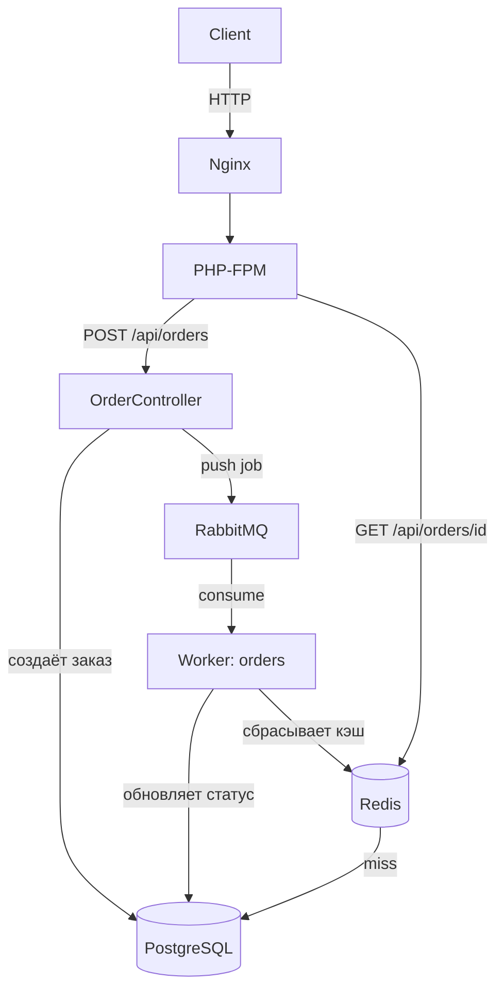

# Yii2 Order Flow


Учебный REST API для работы с заказами на Yii2. Создание заказа ставит задачу в очередь RabbitMQ, воркер обрабатывает её асинхронно, а чтение заказа по ID идёт через кэш в Redis.

Проект сделан, чтобы отработать на практике типичные для бэкенда вещи: очереди и повторные попытки, кэширование с инвалидацией, защиту от гонок между воркерами, тесты и CI.

## Стек

- PHP 8.4, Yii2 Advanced
- PostgreSQL 16
- RabbitMQ 3.13
- Redis 7 (кэш и блокировки)
- Nginx + PHP-FPM, всё в Docker Compose
- Codeception (Unit и Functional)
- GitHub Actions
- Swagger/OpenAPI (`zircote/swagger-php`)

## Как это работает



Коротко по шагам:

1. `POST /api/orders` валидирует данные, сохраняет заказ в PostgreSQL и кладёт `ProcessOrderJob` в очередь `orders`. Клиент сразу получает `201`.
2. Воркер забирает задачу, берёт блокировку в Redis на заказ, обрабатывает его и обновляет статус. После этого кэш заказа сбрасывается.
3. `GET /api/orders/{id}` сначала смотрит в Redis, при промахе читает из БД и кладёт результат в кэш на 5 минут.

## Очереди и обработка ошибок

- Две очереди: `orders` для заказов и `notifications` для email. На каждую свой воркер (`worker` и `worker-notifications`).
- Если задача падает три раза подряд, она переносится в «мёртвую» очередь (`orders_dead`, `notifications_dead`). Повторные попытки и перенос сделаны на уровне приложения, а не настройками брокера.
- Чтобы два воркера не обработали один и тот же заказ одновременно, перед обработкой берётся распределённая блокировка в Redis.

## Запуск

Нужны Docker и Docker Compose.

```bash
git clone https://github.com/your-username/yii2-order-flow.git
cd yii2-order-flow

# локальные конфиги из шаблонов
for f in common/config/main-local common/config/params-local common/config/test-local \
         frontend/config/main-local frontend/config/params-local frontend/config/test-local \
         console/config/main-local console/config/params-local; do
  cp "$f.php.dist" "$f.php"
done

docker compose up -d --build
docker compose exec app composer install
docker compose exec app php yii migrate --interactive=0
docker compose exec app php yii swagger/generate
```

На Windows (PowerShell) конфиги проще скопировать вручную или через Git Bash, остальные команды те же.

После запуска доступно:

| Сервис | Адрес |
|---|---|
| API | http://localhost:20080/api/orders |
| Swagger UI | http://localhost:20080/api-doc |
| RabbitMQ Management | http://localhost:15672 |
| PostgreSQL | localhost:5433 |

Логин и пароль RabbitMQ задаются в `docker-compose.yml`.

## API

| Метод | Путь | Описание |
|---|---|---|
| GET | `/api/orders` | Список заказов, по 20 на страницу |
| GET | `/api/orders/{id}` | Заказ по ID, ответ кэшируется на 5 минут |
| POST | `/api/orders` | Создать заказ |
| GET | `/api/health` | Проверка работоспособности |

Пример создания заказа:

```bash
curl -X POST http://localhost:20080/api/orders \
  -H "Content-Type: application/json" \
  -d '{
        "user_id": 1,
        "items": [
          {"product_name": "Book", "price": "500.00", "quantity": 2}
        ]
      }'
```

При ошибке валидации приходит `422` и тело вида `{"success": false, "errors": {...}}`.

Полное описание эндпоинтов в Swagger UI. Спецификация генерируется из PHP-атрибутов командой `php yii swagger/generate` и записывается в `frontend/web/swagger.json`.

## Тесты

```bash
# Unit
docker compose exec app-test vendor/bin/codecept run Unit -c common

# Functional
docker compose exec app-test vendor/bin/codecept run Functional -c frontend
```

В GitHub Actions при пуше в `main` запускаются unit-тесты.

## Что можно улучшить

- Описать модели `Order` и `OrderItem` в Swagger как схемы, сейчас в ответах только текстовые описания.
- Добавить авторизацию на API.
- Запускать в CI и функциональные тесты.
- Эндпоинт `GET /api/test-email` нужен только для проверки очереди `notifications`, в боевом окружении его стоит отключить.
